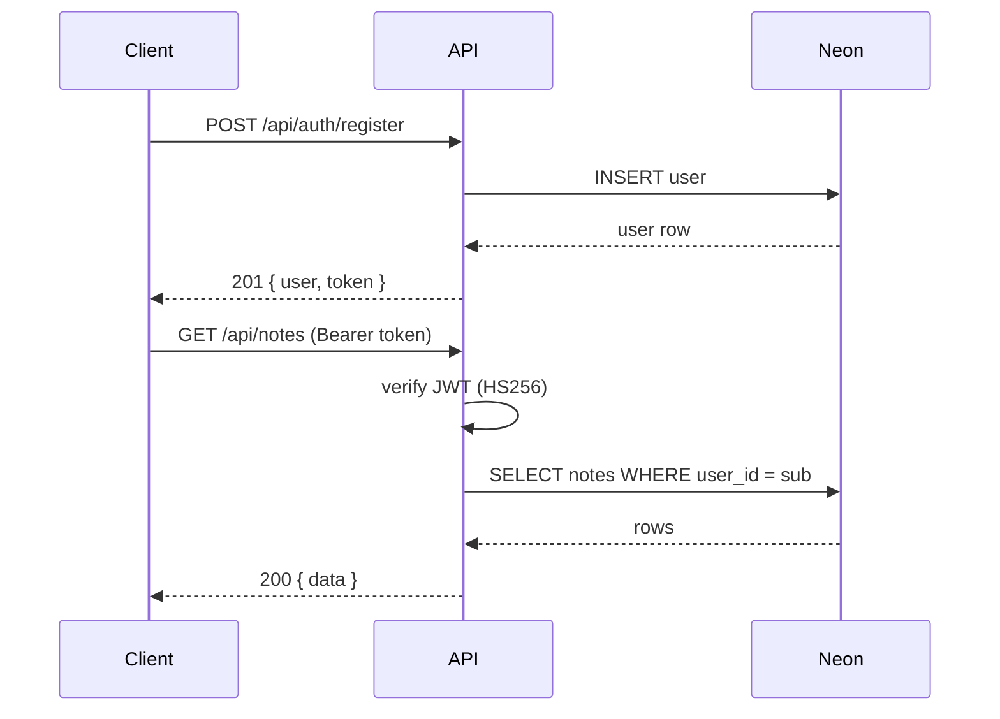

# Notes API

REST API for users and notes. Node.js 20, Express 5 (ES modules), Neon Postgres.

## Setup

1. Create a Neon project and copy its connection string.
2. Copy `.env.example` to `.env` and fill in `DATABASE_URL`, `JWT_SECRET` (>=32 chars), `PORT`.
3. Run the schema: `psql $DATABASE_URL -f db/schema.sql`.
4. `npm install && npm run dev`.

## Endpoints

| Method | Path | Auth | Description |
|---|---|---|---|
| GET | /api/health | no | DB health check |
| POST | /api/auth/register | no | Create user, returns token |
| POST | /api/auth/login | no | Returns token |
| GET | /api/auth/me | yes | Current user |
| GET | /api/notes | yes | List (q, tag, pinned, page, limit) |
| GET | /api/notes/:id | yes | Get one |
| POST | /api/notes | yes | Create |
| PATCH | /api/notes/:id | yes | Update |
| DELETE | /api/notes/:id | yes | Delete |

## Auth flow

## Security

- Helmet security headers, CORS allowlist, 100kb body limit.
- Rate limiting on auth routes (10/15min/IP).
- bcrypt cost 12 password hashing.
- JWT signed HS256 with >=32-char secret, 1h expiry; algorithms restricted on verify.
- Parameterized tagged-template SQL; ownership enforced with `AND user_id` (404 on foreign notes).
- Zod validation -> 422 field errors; no stack traces/SQL leaked in production.
- UUID validation on :id.

## Tests

Tests use `node:test` + supertest against `TEST_DATABASE_URL` (a separate Neon branch). Create a branch in Neon, set `TEST_DATABASE_URL`, run `npm test`.

## Neon branching

Neon supports branching the database (like git). Create a test branch from main, point `TEST_DATABASE_URL` at it, so tests never touch production data.
EOF
echo done